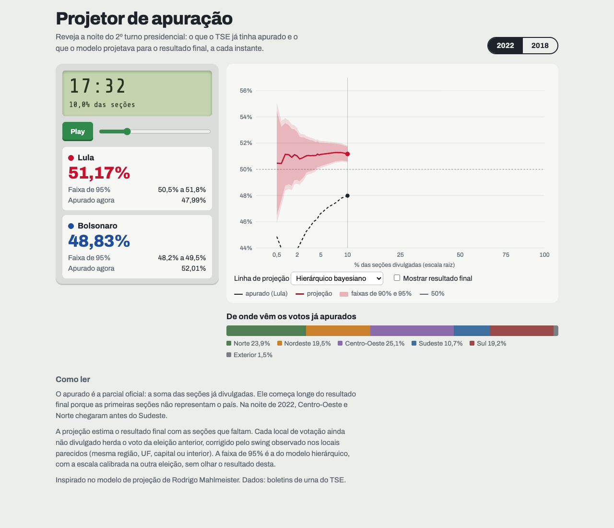

# projetor-apuracao

Projeta, a cada instante da noite eleitoral, o resultado final do 2º turno presidencial a partir da apuração parcial do TSE, com faixas que cumprem o que prometem. Os resultados vêm de um backtest sem vazamento em 2018 e 2022.



As primeiras seções não representam o país. Em 2022, com 5% das seções divulgadas, a parcial de Lula estava 4,3 pontos abaixo do resultado final, porque Centro-Oeste e Norte chegaram antes do Sudeste. O projetor corrige esse viés com o swing de cada local de votação contra a eleição anterior e um modelo hierárquico bayesiano. Com 0,5% das seções, ele erra 0,4 ponto e, dali em diante, nunca mais de 0,3.

## Resultados

Erro absoluto do % do PT nos votos válidos (pontos percentuais), em média sobre 22 instantes da apuração, de 0,5% a 95% das seções:

| Modelo | 2022 | 2018 | 2022: erro < 0,5 a partir de |
|---|---|---|---|
| Apurado (a parcial) | 2,19 | 2,47 | 85% das seções |
| Swing por UF | 0,41 | 0,51 | 5% |
| Regressão em camadas (região, UF, capital) | 0,32 | **0,22** | 1% |
| **Hierárquico bayesiano (Student-t)** | **0,14** | 0,37 | **0,5%** |

Faixa de 90% (cobertura = fração dos instantes em que o resultado final ficou dentro da faixa):

| Faixa | 2022 | 2018 |
|---|---|---|
| Posterior do hierárquico, como sai do modelo | 18% | 45% |
| Conformal no erro do modelo em camadas | 95% | 64% |
| **Posterior recalibrada pela outra eleição** | **100%** | **86%** |

No 1º turno, com o mesmo pipeline e o alvo como % do PT nos válidos de todos os candidatos, o hierárquico erra 0,18 ponto em 2022 e 0,51 em 2018 (o swing por UF erra 0,25 nessa noite). Um termo de erro comum às pendentes, calibrado nas outras noites em leave-one-night-out, eleva a cobertura de 90% da posterior de 41% para 75% nas quatro noites, com o melhor interval score. Mas ainda não chega ao nominal, porque 2018 1T fica em 14% ([relatório 06](reports/06_melhorias.md)).

Em 2022, a ordem de chegada é a observada. Em 2018, o TSE não publicou o horário de recebimento, então a ordem é simulada a partir da de 2022, e cada modelo usa a eleição anterior (2018 e 2014) como histórico. A discussão completa, inclusive do que não funcionou, está no [artigo](reports/artigo.md).

## Inspiração

A ideia de projetar o swing por local de votação e de mostrar projeção, faixa e apurado lado a lado vem do modelo de projeção de apuração de Rodrigo Mahlmeister (2026).

## Relatórios

| | |
|---|---|
| [Artigo](reports/artigo.md) | O texto completo: problema, dados, backtest, modelos, faixas e limitações |
| [00 — Quem chega primeiro](reports/00_quem_chega_primeiro.md) | Viés da ordem de apuração por região, porte e capital; swing local 2018→2022 |
| [01 — Baselines](reports/01_baselines.md) | Apurado, swing uniforme e swing por UF |
| [02 — Regressões de swing](reports/02_ols.md) | WLS por local e camadas com encolhimento; escolha de k em 2018 |
| [03 — Hierárquico](reports/03_hierarquico.md) | Pooling aprendido em PyMC; ADVI contra NUTS |
| [04 — Faixas](reports/04_intervalos.md) | Cinco métodos de faixa, cobertura e interval score |
| [06 — Melhorias](reports/06_melhorias.md) | 1º turno de 2018 e 2022; erro comum às pendentes, avaliado em leave-one-night-out |

## Replay interativo

`app/` é uma página estática, sem build, que reproduz a noite com um relógio, cartões por candidato e o gráfico do apurado contra a projeção. Ela lê só agregados nacionais (`app/data/replay_{ano}.json`, alguns KB), nada por seção.

Para abrir localmente:

```bash
python -m http.server 8000 --directory app
```

Ela também funciona no celular ([screenshot](reports/figures/05_replay_celular.png)). Depois de subir o servidor, abra http://localhost:8000. Um link como http://localhost:8000/#t=10 abre a noite com 10% das seções divulgadas. Para publicar pelo GitHub Pages, renomeie `app/` para `docs/` (o Pages só publica a raiz ou `/docs`) e ative em Settings → Pages, com a branch `main` e a pasta `/docs`. Num repositório privado, o Pages exige um plano pago.

## Como reproduzir

Requer Python 3.11 ou mais novo e cerca de 1 GB livre: 180 MB de zips do TSE e a venv com PyMC.

```bash
python -m venv .venv
.venv/bin/pip install -e ".[dev]"
```

```bash
.venv/bin/python -m projetor.ingest --anos 2014 2018 2022 --turno 2
```

```bash
.venv/bin/python -m projetor.locais
```

```bash
.venv/bin/python -m projetor.ordem
```

Para o 1º turno (~1,3 GB de zips por ano, apagados depois de virar parquet):

```bash
.venv/bin/python -m projetor.ingest --anos 2014 2018 2022 --turno 1
```

```bash
.venv/bin/python -m projetor.ordem --turno 1
```

```bash
.venv/bin/pytest
```

Os relatórios saem dos scripts em `notebooks/`, rodados da raiz do repositório, em ordem:

- `00_quem_chega_primeiro.py`
- `01_baselines.py`
- `02_ols.py`
- `03_hierarquico.py`
- `04a_amostras_hierarquico.py` (~30 min)
- `04b_faixas_camadas.py` (~40 min)
- `04_intervalos.py`
- `05_exportar_app.py` (~1 h)
- `06a_primeiro_turno.py` (~1 h)
- `06_melhorias.py`

O que é pesado vai para `data/`, que não é versionado.

## Estrutura

```
src/projetor/
  ingest.py        baixa os BUs do TSE (com hash), normaliza e agrega Presidente por seção
  tempo.py         fusos: encerramento em hora local, recebimento em hora de Brasília
  locais.py        pareia locais de votação entre eleições
  ordem.py         relógio de chegada: observado em 2022, simulado em 2018
  historico.py     resultado da eleição anterior por local, com fallback por zona/município/UF
  replay.py        estado da apuração num instante, sem vazamento
  backtest.py      simulador da noite: pendentes só com covariáveis permitidas
  votos.py         válidos (inclui outros candidatos no 1º turno) e troca de alvo
  intervals.py     faixas analítica, bootstrap, posterior, conformal e recalibrada
  discrepancia.py  erro comum às pendentes: perfil da noite, calibração e aplicação
  models/
    baseline.py    Apurado, SwingUniforme, SwingUniformeUF
    ols.py         SwingOLS
    camadas.py     SwingCamadas e variantes com encolhimento por nível
    hierarquico.py SwingHierarquico (PyMC, normal ou Student-t)
notebooks/         scripts que geram cada relatório
reports/           relatórios, artigo e figuras
app/               replay interativo estático
tests/             testes, inclusive os de não vazamento
```

## Dados

Boletins de urna do portal de dados abertos do TSE (`dadosabertos.tse.jus.br`), datasets `resultados-{2014,2018,2022}-boletim-de-urna`, 1º e 2º turnos, 27 UFs e exterior. Os votos do PT e do adversário batem voto a voto com o resultado oficial nos seis pleitos. A única diferença está nos válidos do 1º turno de 2018, 746 votos (0,0007%) a mais.
