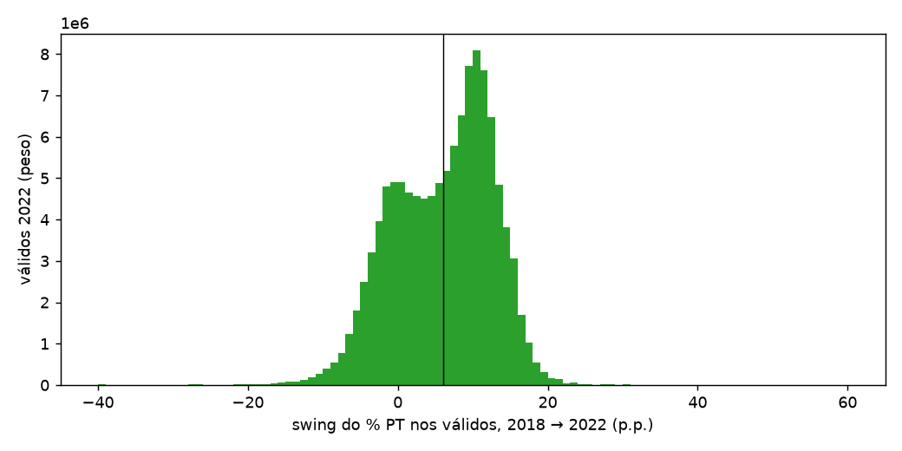

# 00 — Quem chega primeiro na apuração (2º turno)

## Viés das primeiras seções — 2022

Participação de cada grupo nos votos válidos finais e entre as seções divulgadas até 10%, 25% e 50% do relógio.

| regiao       |   % válidos final |   % até 10% |   % até 25% |   % até 50% |   razão até 10% |   % PT no grupo |
|:-------------|------------------:|------------:|------------:|------------:|----------------:|----------------:|
| Centro-Oeste |              7.47 |       25.14 |       17.21 |       11.99 |            3.37 |           39.79 |
| Exterior     |              0.25 |        1.51 |        0.62 |        0.32 |            6    |           51.28 |
| Nordeste     |             27.41 |       19.48 |       22.86 |       26.41 |            0.71 |           69.34 |
| Norte        |              7.91 |       23.94 |       16.37 |       11.86 |            3.03 |           48.97 |
| Sudeste      |             42.04 |       10.74 |       21.61 |       30.87 |            0.26 |           45.74 |
| Sul          |             14.92 |       19.19 |       21.34 |       18.54 |            1.29 |           38.16 |

| porte   |   % válidos final |   % até 10% |   % até 25% |   % até 50% |   razão até 10% |   % PT no grupo |
|:--------|------------------:|------------:|------------:|------------:|----------------:|----------------:|
| Q1      |             19.73 |       26.51 |       25.89 |       21.57 |            1.34 |           57.95 |
| Q2      |             19.59 |       15.9  |       21.57 |       22.69 |            0.81 |           55.61 |
| Q3      |             20.09 |        8.2  |       12.65 |       16.46 |            0.41 |           46.13 |
| Q4      |             20.35 |       16.78 |       17.31 |       19.53 |            0.82 |           45.18 |
| Q5      |             20.24 |       32.6  |       22.58 |       19.74 |            1.61 |           49.96 |

| capital   |   % válidos final |   % até 10% |   % até 25% |   % até 50% |   razão até 10% |   % PT no grupo |
|:----------|------------------:|------------:|------------:|------------:|----------------:|----------------:|
| Capital   |             23.47 |       43.8  |       30.97 |       25.95 |            1.87 |           49.69 |
| Exterior  |              0.25 |        1.51 |        0.62 |        0.32 |            6    |           51.28 |
| Interior  |             76.27 |       54.69 |       68.41 |       73.73 |            0.72 |           51.27 |

Limites dos quintis de porte (2022):

| porte   |   menor município (aptos) |   maior município (aptos) |   municípios |
|:--------|--------------------------:|--------------------------:|-------------:|
| Q1      |                        30 |                     18423 |         4227 |
| Q2      |                     18436 |                     56127 |         1052 |
| Q3      |                     56349 |                    189115 |          326 |
| Q4      |                    191612 |                    753009 |           91 |
| Q5      |                    881208 |                   9320585 |           14 |

## Parcial do PT x % apurado

Final 2022: 50.90% (Lula). Final 2018: 44.87% (Haddad). Em 2022 a parcial de Lula passa de 50% com ~68% das seções divulgadas.

|                |   2022 % PT parcial |   2022 erro vs final (p.p.) |   2018 (simulado) % PT parcial |   2018 erro vs final (p.p.) |
|:---------------|--------------------:|----------------------------:|-------------------------------:|----------------------------:|
| 5% das seções  |               46.63 |                       -4.27 |                          40.35 |                       -4.52 |
| 10% das seções |               47.99 |                       -2.91 |                          42.51 |                       -2.36 |
| 25% das seções |               48.75 |                       -2.15 |                          43.49 |                       -1.38 |
| 50% das seções |               49.7  |                       -1.21 |                          44.14 |                       -0.73 |
| 75% das seções |               50.18 |                       -0.73 |                          44.24 |                       -0.63 |
| 90% das seções |               50.53 |                       -0.37 |                          44.51 |                       -0.36 |

## Swing local 2018 → 2022

89,088 locais pareados. Swing nacional: +6.03 p.p. Desvio e média ponderados pelos válidos de 2022; quantis sem peso.

|              |   locais |   média pond. |   desvio pond. |    p05 |   p25 |   mediana |   p75 |   p95 |
|:-------------|---------:|--------------:|---------------:|-------:|------:|----------:|------:|------:|
| Brasil       |    89088 |          5.98 |           6.71 |  -8.57 | -2.34 |      2.29 |  8.68 | 14.26 |
| Centro-Oeste |     5326 |          6.25 |           5.1  |  -7.16 |  0.66 |      5.01 |  8.89 | 12.3  |
| Exterior     |      151 |         17.52 |           7.97 |  -3.89 |  8.84 |     17.51 | 21.88 | 33.05 |
| Nordeste     |    32146 |         -0.26 |           4.4  |  -8.92 | -4.16 |     -1.6  |  0.92 |  5.58 |
| Norte        |     9172 |          0.22 |           6.13 | -16.03 | -6.34 |     -1.72 |  2.43 |  8.79 |
| Sudeste      |    26477 |         10.77 |           4.36 |  -2.53 |  6.28 |     10.04 | 12.78 | 16.42 |
| Sul          |    15816 |          6.48 |           4.82 |  -7.27 |  0.08 |      4.81 |  8.33 | 12.28 |

Por fase de chegada do local em 2022 (mediana do relógio das suas seções):

| fase      |   locais |   média pond. |   desvio pond. |   p05 |   p25 |   mediana |   p75 |   p95 |
|:----------|---------:|--------------:|---------------:|------:|------:|----------:|------:|------:|
| 1º quarto |    20815 |          5.12 |           6.12 | -7.89 | -1.32 |      3.26 |  8.24 | 13.33 |
| 2º quarto |    21571 |          5.71 |           6.57 | -7.8  | -1.86 |      2.83 |  8.83 | 14.34 |
| 3º quarto |    22233 |          6.67 |           6.92 | -8.44 | -2.44 |      2.33 |  9.37 | 14.89 |
| 4º quarto |    24469 |          6.4  |           7.09 | -9.62 | -3.41 |      0.75 |  8.32 | 14.26 |

