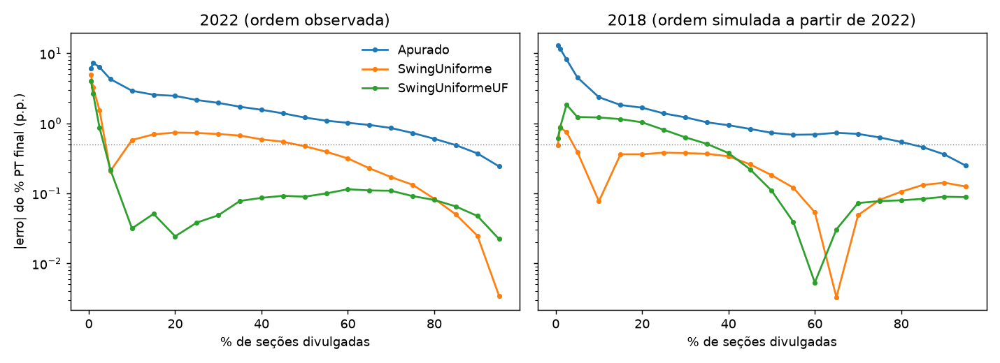

# 01 — Baselines no 2º turno

Erro absoluto, em pontos percentuais, do % PT final nos válidos projetado em cada ponto do relógio. "Tempo até cravar" é o primeiro % de seções a partir do qual o |erro| fica abaixo de 0,5 p.p. e não sai mais (na grade até 95%).

- `Apurado`: a parcial.
- `SwingUniforme`: swing nacional das seções divulgadas contra a eleição anterior, aplicado ao % PT anterior de cada pendente; peso das pendentes = aptos × (válidos/aptos da eleição anterior).
- `SwingUniformeUF`: swing por UF (mínimo de 30 seções divulgadas; senão, o nacional).

## 2022 — ordem observada, histórico de 2018

Nível do histórico usado (% das seções): {'local': 97.8, 'zona': 2.2, 'municipio': 0.0, 'uf': 0.0}

|                                 |   Apurado |   SwingUniforme |   SwingUniformeUF |
|:--------------------------------|----------:|----------------:|------------------:|
| 0.5%                            |      6.03 |            4.91 |              4.03 |
| 1%                              |      7.34 |            3.23 |              2.66 |
| 2.5%                            |      6.3  |            1.52 |              0.86 |
| 5%                              |      4.27 |            0.21 |              0.22 |
| 10%                             |      2.91 |            0.58 |              0.03 |
| 15%                             |      2.56 |            0.69 |              0.05 |
| 20%                             |      2.46 |            0.74 |              0.02 |
| 25%                             |      2.15 |            0.73 |              0.04 |
| 30%                             |      1.96 |            0.7  |              0.05 |
| 35%                             |      1.72 |            0.67 |              0.08 |
| 40%                             |      1.56 |            0.59 |              0.09 |
| 45%                             |      1.39 |            0.54 |              0.09 |
| 50%                             |      1.21 |            0.47 |              0.09 |
| 55%                             |      1.09 |            0.39 |              0.1  |
| 60%                             |      1.02 |            0.31 |              0.11 |
| 65%                             |      0.95 |            0.23 |              0.11 |
| 70%                             |      0.86 |            0.17 |              0.11 |
| 75%                             |      0.73 |            0.13 |              0.09 |
| 80%                             |      0.6  |            0.08 |              0.08 |
| 85%                             |      0.49 |            0.05 |              0.06 |
| 90%                             |      0.37 |            0.02 |              0.05 |
| 95%                             |      0.24 |            0    |              0.02 |
| média                           |      2.19 |            0.77 |              0.41 |
| tempo até cravar (|erro| < 0,5) |     85    |           50    |              5    |

## 2018 — ordem simulada a partir de 2022, histórico de 2014

Nível do histórico usado (% das seções): {'local': 89.0, 'zona': 9.3, 'municipio': 1.7, 'uf': 0.0}

|                                 |   Apurado |   SwingUniforme |   SwingUniformeUF |
|:--------------------------------|----------:|----------------:|------------------:|
| 0.5%                            |     12.88 |            0.49 |              0.61 |
| 1%                              |     11.68 |            0.88 |              0.86 |
| 2.5%                            |      8.17 |            0.75 |              1.85 |
| 5%                              |      4.52 |            0.39 |              1.23 |
| 10%                             |      2.36 |            0.08 |              1.21 |
| 15%                             |      1.83 |            0.36 |              1.15 |
| 20%                             |      1.67 |            0.36 |              1.03 |
| 25%                             |      1.38 |            0.38 |              0.81 |
| 30%                             |      1.22 |            0.38 |              0.63 |
| 35%                             |      1.03 |            0.37 |              0.51 |
| 40%                             |      0.94 |            0.34 |              0.38 |
| 45%                             |      0.83 |            0.26 |              0.22 |
| 50%                             |      0.73 |            0.18 |              0.11 |
| 55%                             |      0.68 |            0.12 |              0.04 |
| 60%                             |      0.69 |            0.05 |              0.01 |
| 65%                             |      0.73 |            0    |              0.03 |
| 70%                             |      0.7  |            0.05 |              0.07 |
| 75%                             |      0.63 |            0.08 |              0.08 |
| 80%                             |      0.54 |            0.11 |              0.08 |
| 85%                             |      0.46 |            0.13 |              0.08 |
| 90%                             |      0.36 |            0.14 |              0.09 |
| 95%                             |      0.25 |            0.12 |              0.09 |
| média                           |      2.47 |            0.27 |              0.51 |
| tempo até cravar (|erro| < 0,5) |     85    |            5    |             40    |

Em 2018 a ordem de chegada é simulada (herdada de 2022, ver `projetor.ordem`); o erro mede o modelo sob a ordem de 2022, não sob a da noite de 2018.
