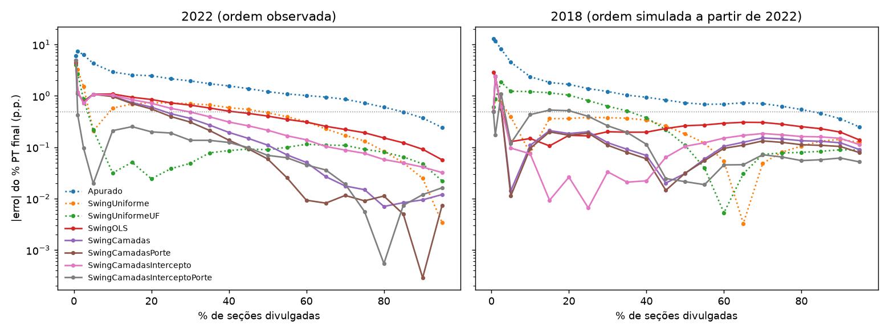

# 02 — Regressões de swing no 2º turno

Mesmo backtest e métricas da fase 1: |erro| em p.p. do % PT final nos válidos; tempo até cravar = primeiro % de seções a partir do qual o |erro| fica abaixo de 0,5 p.p. até 95%.

- `SwingOLS`: WLS por local, `swing ~ 1 + ant_pct_pt + log(aptos do município) + capital`, ponderada pelos válidos esperados; swing uniforme até 200 locais divulgados.
- `SwingCamadas`: a mesma WLS no nacional, na região e na UF, cada nível encolhido para o de cima com peso n/(n + k); grupos com menos de 20 locais têm peso 0.
- `SwingCamadasPorte`: `SwingCamadas` com um quarto nível, UF × capital/interior.
- `SwingCamadasIntercepto`: regressão só no nacional; região e UF estimam um deslocamento (efeito fixo) encolhido com o mesmo n/(n + k).
- `SwingCamadasInterceptoPorte`: o anterior com o nível UF × capital/interior.

## Escolha de k e do mínimo de locais (só em 2018)

Erro absoluto médio em 2018. A combinação de menor erro foi fixada e só então o modelo rodou em 2022.

|                |   SwingCamadas |   SwingCamadasPorte |   SwingCamadasIntercepto |   SwingCamadasInterceptoPorte |
|:---------------|---------------:|--------------------:|-------------------------:|------------------------------:|
| (200, 30)      |          0.428 |               0.434 |                    0.318 |                         0.248 |
| (200, 100)     |          0.446 |               0.445 |                    0.418 |                         0.334 |
| (200, 300)     |          0.479 |               0.473 |                    0.465 |                         0.402 |
| (200, 1000)    |          0.45  |               0.441 |                    0.462 |                         0.439 |
| (200, 3000)    |          0.421 |               0.41  |                    0.425 |                         0.425 |
| (200, 10000)   |          0.361 |               0.35  |                    0.357 |                         0.362 |
| (200, 30000)   |          0.362 |               0.361 |                    0.353 |                         0.352 |
| (200, 100000)  |          0.418 |               0.419 |                    0.415 |                         0.414 |
| (1000, 30)     |          0.432 |               0.436 |                    0.293 |                         0.22  |
| (1000, 100)    |          0.386 |               0.385 |                    0.345 |                         0.26  |
| (1000, 300)    |          0.389 |               0.384 |                    0.37  |                         0.306 |
| (1000, 1000)   |          0.347 |               0.339 |                    0.357 |                         0.335 |
| (1000, 3000)   |          0.314 |               0.303 |                    0.317 |                         0.318 |
| (1000, 10000)  |          0.253 |               0.242 |                    0.248 |                         0.253 |
| (1000, 30000)  |          0.253 |               0.253 |                    0.244 |                         0.243 |
| (1000, 100000) |          0.31  |               0.311 |                    0.306 |                         0.305 |

Escolhas (min_locais, k): `SwingCamadas` = (np.int64(1000), np.int64(10000)); `SwingCamadasPorte` = (np.int64(1000), np.int64(10000)); `SwingCamadasIntercepto` = (np.int64(1000), np.int64(30000)); `SwingCamadasInterceptoPorte` = (np.int64(1000), np.int64(30)).

## 2022 — ordem observada, histórico de 2018

|                                 |   Apurado |   SwingUniforme |   SwingUniformeUF |   SwingOLS |   SwingCamadas |   SwingCamadasPorte |   SwingCamadasIntercepto |   SwingCamadasInterceptoPorte |
|:--------------------------------|----------:|----------------:|------------------:|-----------:|---------------:|--------------------:|-------------------------:|------------------------------:|
| 0.5%                            |      6.03 |            4.91 |              4.03 |       4.4  |           4.91 |                4.91 |                     4.91 |                          4.91 |
| 1%                              |      7.34 |            3.23 |              2.66 |       1.19 |           1.12 |                1.11 |                     1.18 |                          0.42 |
| 2.5%                            |      6.3  |            1.52 |              0.86 |       0.73 |           0.78 |                0.78 |                     0.73 |                          0.1  |
| 5%                              |      4.27 |            0.21 |              0.22 |       1.08 |           1.07 |                1.07 |                     1.06 |                          0.02 |
| 10%                             |      2.91 |            0.58 |              0.03 |       1.09 |           0.99 |                0.97 |                     1.03 |                          0.21 |
| 15%                             |      2.56 |            0.69 |              0.05 |       0.94 |           0.74 |                0.7  |                     0.84 |                          0.25 |
| 20%                             |      2.46 |            0.74 |              0.02 |       0.85 |           0.6  |                0.56 |                     0.72 |                          0.2  |
| 25%                             |      2.15 |            0.73 |              0.04 |       0.73 |           0.45 |                0.4  |                     0.57 |                          0.19 |
| 30%                             |      1.96 |            0.7  |              0.05 |       0.66 |           0.37 |                0.31 |                     0.49 |                          0.14 |
| 35%                             |      1.72 |            0.67 |              0.08 |       0.58 |           0.27 |                0.21 |                     0.39 |                          0.14 |
| 40%                             |      1.56 |            0.59 |              0.09 |       0.5  |           0.19 |                0.14 |                     0.31 |                          0.12 |
| 45%                             |      1.39 |            0.54 |              0.09 |       0.46 |           0.15 |                0.09 |                     0.26 |                          0.1  |
| 50%                             |      1.21 |            0.47 |              0.09 |       0.4  |           0.11 |                0.06 |                     0.21 |                          0.07 |
| 55%                             |      1.09 |            0.39 |              0.1  |       0.35 |           0.07 |                0.03 |                     0.17 |                          0.06 |
| 60%                             |      1.02 |            0.31 |              0.11 |       0.31 |           0.05 |                0.01 |                     0.14 |                          0.05 |
| 65%                             |      0.95 |            0.23 |              0.11 |       0.26 |           0.03 |                0.01 |                     0.1  |                          0.04 |
| 70%                             |      0.86 |            0.17 |              0.11 |       0.22 |           0.02 |                0.01 |                     0.09 |                          0.02 |
| 75%                             |      0.73 |            0.13 |              0.09 |       0.19 |           0.01 |                0.01 |                     0.08 |                          0.01 |
| 80%                             |      0.6  |            0.08 |              0.08 |       0.15 |           0.01 |                0.01 |                     0.06 |                          0    |
| 85%                             |      0.49 |            0.05 |              0.06 |       0.12 |           0.01 |                0    |                     0.05 |                          0.01 |
| 90%                             |      0.37 |            0.02 |              0.05 |       0.09 |           0.01 |                0    |                     0.04 |                          0.01 |
| 95%                             |      0.24 |            0    |              0.02 |       0.06 |           0.01 |                0.01 |                     0.03 |                          0.02 |
| média                           |      2.19 |            0.77 |              0.41 |       0.7  |           0.54 |                0.52 |                     0.61 |                          0.32 |
| tempo até cravar (|erro| < 0,5) |     85    |           50    |              5    |      45    |          25    |               25    |                    30    |                          1    |

## 2018 — ordem simulada a partir de 2022, histórico de 2014

|                                 |   Apurado |   SwingUniforme |   SwingUniformeUF |   SwingOLS |   SwingCamadas |   SwingCamadasPorte |   SwingCamadasIntercepto |   SwingCamadasInterceptoPorte |
|:--------------------------------|----------:|----------------:|------------------:|-----------:|---------------:|--------------------:|-------------------------:|------------------------------:|
| 0.5%                            |     12.88 |            0.49 |              0.61 |       2.88 |           0.49 |                0.49 |                     0.49 |                          0.49 |
| 1%                              |     11.68 |            0.88 |              0.86 |       2.42 |           2.39 |                2.39 |                     2.41 |                          0.17 |
| 2.5%                            |      8.17 |            0.75 |              1.85 |       0.64 |           0.57 |                0.56 |                     0.63 |                          1.1  |
| 5%                              |      4.52 |            0.39 |              1.23 |       0.13 |           0.01 |                0.01 |                     0.1  |                          0.12 |
| 10%                             |      2.36 |            0.08 |              1.21 |       0.15 |           0.11 |                0.1  |                     0.07 |                          0.43 |
| 15%                             |      1.83 |            0.36 |              1.15 |       0.11 |           0.21 |                0.2  |                     0.01 |                          0.53 |
| 20%                             |      1.67 |            0.36 |              1.03 |       0.17 |           0.18 |                0.17 |                     0.03 |                          0.52 |
| 25%                             |      1.38 |            0.38 |              0.81 |       0.17 |           0.2  |                0.19 |                     0.01 |                          0.4  |
| 30%                             |      1.22 |            0.38 |              0.63 |       0.2  |           0.12 |                0.11 |                     0.03 |                          0.26 |
| 35%                             |      1.03 |            0.37 |              0.51 |       0.2  |           0.09 |                0.08 |                     0.02 |                          0.19 |
| 40%                             |      0.94 |            0.34 |              0.38 |       0.2  |           0.07 |                0.06 |                     0.02 |                          0.11 |
| 45%                             |      0.83 |            0.26 |              0.22 |       0.23 |           0.02 |                0.01 |                     0.06 |                          0.02 |
| 50%                             |      0.73 |            0.18 |              0.11 |       0.26 |           0.03 |                0.03 |                     0.1  |                          0.02 |
| 55%                             |      0.68 |            0.12 |              0.04 |       0.27 |           0.06 |                0.05 |                     0.12 |                          0.02 |
| 60%                             |      0.69 |            0.05 |              0.01 |       0.29 |           0.1  |                0.1  |                     0.15 |                          0.05 |
| 65%                             |      0.73 |            0    |              0.03 |       0.31 |           0.13 |                0.11 |                     0.17 |                          0.05 |
| 70%                             |      0.7  |            0.05 |              0.07 |       0.3  |           0.15 |                0.13 |                     0.18 |                          0.07 |
| 75%                             |      0.63 |            0.08 |              0.08 |       0.28 |           0.15 |                0.12 |                     0.17 |                          0.06 |
| 80%                             |      0.54 |            0.11 |              0.08 |       0.25 |           0.13 |                0.11 |                     0.16 |                          0.05 |
| 85%                             |      0.46 |            0.13 |              0.08 |       0.23 |           0.13 |                0.11 |                     0.16 |                          0.06 |
| 90%                             |      0.36 |            0.14 |              0.09 |       0.2  |           0.12 |                0.1  |                     0.15 |                          0.06 |
| 95%                             |      0.25 |            0.12 |              0.09 |       0.14 |           0.09 |                0.08 |                     0.11 |                          0.05 |
| média                           |      2.47 |            0.27 |              0.51 |       0.46 |           0.25 |                0.24 |                     0.24 |                          0.22 |
| tempo até cravar (|erro| < 0,5) |     85    |            5    |             40    |       5    |           5    |                5    |                     5    |                         25    |

## Erro com sinal (projeção − final, p.p.)

|              |   Apurado |   SwingUniforme |   SwingUniformeUF |   SwingOLS |   SwingCamadas |   SwingCamadasPorte |   SwingCamadasIntercepto |   SwingCamadasInterceptoPorte |
|:-------------|----------:|----------------:|------------------:|-----------:|---------------:|--------------------:|-------------------------:|------------------------------:|
| (2018, 0.01) |    -11.68 |           -0.88 |              0.86 |      -2.42 |          -2.39 |               -2.39 |                    -2.41 |                         -0.17 |
| (2018, 0.05) |     -4.52 |           -0.39 |              1.23 |      -0.13 |           0.01 |                0.01 |                    -0.1  |                         -0.12 |
| (2018, 0.1)  |     -2.36 |            0.08 |              1.21 |      -0.15 |           0.11 |                0.1  |                    -0.07 |                          0.43 |
| (2018, 0.25) |     -1.38 |            0.38 |              0.81 |      -0.17 |           0.2  |                0.19 |                    -0.01 |                          0.4  |
| (2018, 0.5)  |     -0.73 |            0.18 |              0.11 |      -0.26 |          -0.03 |               -0.03 |                    -0.1  |                          0.02 |
| (2022, 0.01) |     -7.34 |            3.23 |              2.66 |       1.19 |           1.12 |                1.11 |                     1.18 |                          0.42 |
| (2022, 0.05) |     -4.27 |            0.21 |             -0.22 |      -1.08 |          -1.07 |               -1.07 |                    -1.06 |                          0.02 |
| (2022, 0.1)  |     -2.91 |           -0.58 |             -0.03 |      -1.09 |          -0.99 |               -0.97 |                    -1.03 |                          0.21 |
| (2022, 0.25) |     -2.15 |           -0.73 |              0.04 |      -0.73 |          -0.45 |               -0.4  |                    -0.57 |                          0.19 |
| (2022, 0.5)  |     -1.21 |           -0.47 |              0.09 |      -0.4  |          -0.11 |               -0.06 |                    -0.21 |                          0.07 |

## Coeficientes do nacional em 2022 (`SwingOLS`)

Swing em p.p.; `log_aptos_mun` por unidade de log do eleitorado do município.

|               |    10% |    50% |
|:--------------|-------:|-------:|
| intercepto    |  3.972 |  0.005 |
| ant_pct_pt    | -0.169 | -0.176 |
| log_aptos_mun |  0.705 |  1.167 |
| capital       |  0.2   | -1.568 |

## O que funcionou e o que não funcionou

**O que funcionou.** O melhor modelo nos dois anos é `SwingCamadasInterceptoPorte`: uma regressão nacional, com deslocamentos encolhidos por região, UF e UF × capital/interior.

- Em 2022 (teste), o erro médio é 0,32 p.p., contra 0,41 do melhor baseline (`SwingUniformeUF`). O |erro| fica abaixo de 0,5 p.p. a partir de 1% das seções e abaixo de 0,25 a partir de 2,5%.
- Em 2018 (treino), o erro médio é 0,22, contra 0,27 do `SwingUniforme`.
- O nível UF × capital/interior melhorou as duas famílias em 2018: 0,220 contra 0,244 no modo intercepto e 0,242 contra 0,253 no modo regressão. Por isso foi mantido. Em 2022 também ajuda: 0,32 contra 0,61 no intercepto e 0,52 contra 0,54 na regressão.
- Em 2022, a regressão nacional mostra que o swing pró-PT foi maior onde o PT tinha menos voto (−0,17 p.p. por ponto de `ant_pct_pt`) e nos municípios maiores.

**O que não funcionou.**

- A WLS nacional sozinha (`SwingOLS`) é pior que o swing por UF em 2022, com média de 0,70. Ela subestima Lula em cerca de 1 p.p. entre 5% e 10% das seções. Com essas três covariáveis, não captura o swing regional (Sudeste +10,8 p.p. contra Nordeste −0,3), e as primeiras seções vêm de regiões com swing menor.
- As regressões completas por região e UF (`SwingCamadas`, `SwingCamadasPorte`) precisaram de k entre 10.000 e 30.000 para não piorar, ou seja, ficaram quase iguais ao nacional. Ajustar 4 parâmetros por UF com poucos locais é ruído demais.
- Com 0,5% das seções e `min_locais = 1000`, todos os modelos em camadas ainda usam o swing uniforme e erram 4,9 p.p. em 2022. Até ~1% das seções, nenhum modelo é confiável.
- O coeficiente de `capital` troca de sinal entre 10% (+0,2) e 50% (−1,6) das seções em 2022. Isso mostra que as primeiras capitais a chegar não representam as que chegam depois.

**Ressalvas honestas.**

1. O par escolhido para `SwingCamadasInterceptoPorte` (k = 30, `min_locais` = 1000) está no limite inferior da grade de k. Um k menor talvez fosse ainda melhor em 2018. Não estendi a grade para não continuar ajustando.
2. Escolher k, `min_locais` e a variante em 2018 não deixa 2022 totalmente independente: a ordem de chegada de 2018 é simulada a partir da de 2022. A ordem de 2022 entrou no treino, embora os votos de 2022 não. O 2022 é um teste "fora da amostra de votos", não um teste cego.
3. O erro de 2018 mede o modelo sob a ordem de 2022, não sob a noite real de 2018.
4. Ainda não há intervalos: estes números são só de erro pontual. A calibração fica para a próxima fase.
