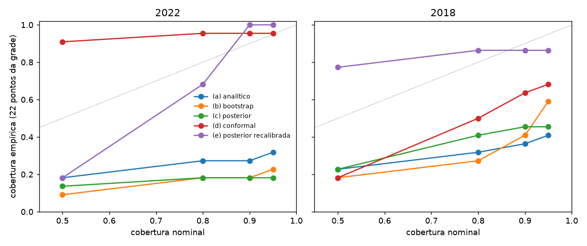
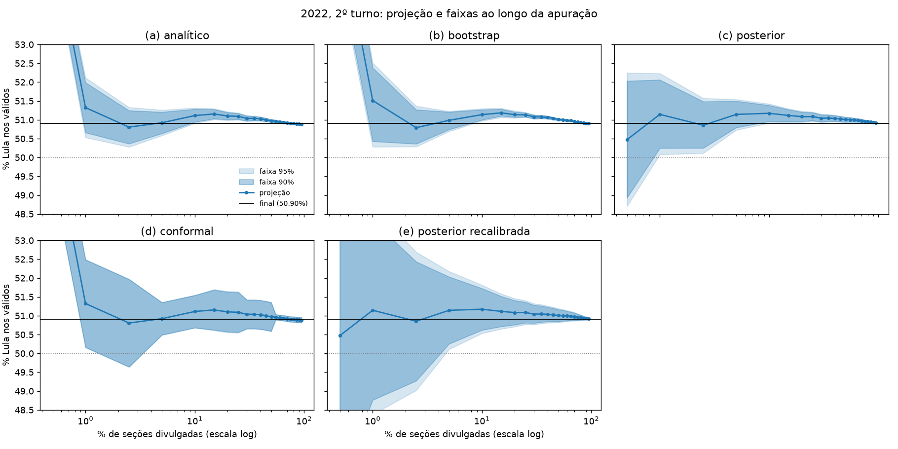

# 04 — Faixas calibradas no 2º turno

Faixas de 90% e 95% para o % PT final em cada um dos 22 pontos da grade, nos dois backtests. Cobertura = fração dos pontos em que o resultado final ficou dentro da faixa. ⚠️ marca cobertura mais de 15 p.p. abaixo da prometida, o que tratamos como bug. Winkler (interval score) = largura + (2/α) × distância até a faixa quando o final fica fora; menor é melhor. Os 22 pontos de uma noite são fortemente correlacionados, então cada cobertura é uma estimativa ruidosa.

- (a) analítico: erro de previsão do `SwingCamadasInterceptoPorte` propagado em forma fechada (coeficientes, deslocamentos por nível, ruído local e comparecimento).
- (b) bootstrap: 200 réplicas reamostrando locais divulgados, com resíduo de swing e de comparecimento sorteado para cada local pendente.
- (c) posterior: amostras do `SwingHierarquico` (verossimilhança t) com incerteza de comparecimento.
- (d) conformal: quantil de |erro| do `SwingCamadasInterceptoPorte` por faixa de relógio, numa grade fina (190 pontos) do outro ano. Em 2022 a calibração vem de 2018 (teste principal, sem olhar 2022); em 2018, vem de 2022.
- (e) posterior recalibrada: centro e desvio de (c), com o desvio multiplicado pelo quantil conformal de |erro|/desvio nos 22 pontos do outro ano.

## Passo 0 — normal × Student-t no hierárquico

Erro absoluto do % PT final (p.p.), ambos com incerteza de comparecimento.

|                  |   erro médio |   erro até 2,5% |   erro 5–95% |   tempo até cravar |   ν médio |
|:-----------------|-------------:|----------------:|-------------:|-------------------:|----------:|
| ('normal', 2022) |        0.171 |           0.609 |        0.102 |                1   |   nan     |
| ('normal', 2018) |        0.401 |           1.705 |        0.195 |                5   |   nan     |
| ('t', 2022)      |        0.136 |           0.241 |        0.12  |                0.5 |     4.284 |
| ('t', 2018)      |        0.37  |           1.926 |        0.124 |                5   |     3.297 |

Escolha: **t** (regra: a t fica se melhorar 2018 sem piorar 2022 em mais de 0,05 p.p.).

## Cobertura, largura e Winkler

|                                     | cobertura 90%   |   largura 90% |   winkler 90% | cobertura 95%   |   largura 95% |   winkler 95% |
|:------------------------------------|:----------------|--------------:|--------------:|:----------------|--------------:|--------------:|
| (2018, '(a) analítico')             | 36% ⚠️          |          0.46 |          1.93 | 41% ⚠️          |          0.54 |          2.71 |
| (2018, '(b) bootstrap')             | 41% ⚠️          |          3.2  |          4.23 | 59% ⚠️          |          4.92 |          5.82 |
| (2018, '(c) posterior')             | 45% ⚠️          |          0.76 |          2.81 | 45% ⚠️          |          0.9  |          3.63 |
| (2018, '(d) conformal')             | 64% ⚠️          |          1.58 |          2.49 | 68% ⚠️          |          1.59 |          3.34 |
| (2018, '(e) posterior recalibrada') | 86%             |          2.24 |          2.34 | 86%             |          2.24 |          2.44 |
| (2022, '(a) analítico')             | 27% ⚠️          |          0.25 |          5    | 32% ⚠️          |          0.3  |          9.35 |
| (2022, '(b) bootstrap')             | 18% ⚠️          |          0.32 |          5.34 | 23% ⚠️          |          0.37 |          9.71 |
| (2022, '(c) posterior')             | 18% ⚠️          |          0.43 |          1.1  | 18% ⚠️          |          0.5  |          1.43 |
| (2022, '(d) conformal')             | 95%             |          0.77 |          4.18 | 95%             |          0.78 |          7.6  |
| (2022, '(e) posterior recalibrada') | 100%            |          1.1  |          1.1  | 100%            |          1.28 |          1.28 |

## Cobertura de 90% por faixa de relógio

|                                     | até 2,5%   | 2,5–10%   | 10–25%   | 25–50%   | 50–95%   |
|:------------------------------------|:-----------|:----------|:---------|:---------|:---------|
| (2018, '(a) analítico')             | 2/3        | 1/2       | 0/3      | 2/5      | 3/9      |
| (2018, '(b) bootstrap')             | 3/3        | 2/2       | 0/3      | 3/5      | 1/9      |
| (2018, '(c) posterior')             | 2/3        | 2/2       | 3/3      | 3/5      | 0/9      |
| (2018, '(d) conformal')             | 3/3        | 1/2       | 0/3      | 3/5      | 7/9      |
| (2018, '(e) posterior recalibrada') | 3/3        | 2/2       | 3/3      | 4/5      | 7/9      |
| (2022, '(a) analítico')             | 2/3        | 1/2       | 0/3      | 0/5      | 3/9      |
| (2022, '(b) bootstrap')             | 2/3        | 1/2       | 0/3      | 0/5      | 1/9      |
| (2022, '(c) posterior')             | 3/3        | 1/2       | 0/3      | 0/5      | 0/9      |
| (2022, '(d) conformal')             | 2/3        | 2/2       | 3/3      | 5/5      | 9/9      |
| (2022, '(e) posterior recalibrada') | 3/3        | 2/2       | 3/3      | 5/5      | 9/9      |

## Quantis conformais usados (|erro| em p.p.)

Calibrados em 2018, aplicados em 2022:

| faixa    |   0.5 |   0.8 |   0.9 |   0.95 |
|:---------|------:|------:|------:|-------:|
| até 2,5% | 0.841 | 1.164 | 1.164 |  1.164 |
| 2,5–10%  | 0.24  | 0.368 | 0.432 |  0.432 |
| 10–25%   | 0.495 | 0.515 | 0.529 |  0.547 |
| 25–50%   | 0.147 | 0.264 | 0.382 |  0.386 |
| 50–95%   | 0.057 | 0.065 | 0.07  |  0.072 |

Calibrados em 2022, aplicados em 2018:

| faixa    |   0.5 |   0.8 |   0.9 |   0.95 |
|:---------|------:|------:|------:|-------:|
| até 2,5% | 0.33  | 4.914 | 4.914 |  4.914 |
| 2,5–10%  | 0.095 | 0.234 | 0.263 |  0.263 |
| 10–25%   | 0.216 | 0.247 | 0.252 |  0.255 |
| 25–50%   | 0.125 | 0.143 | 0.165 |  0.172 |
| 50–95%   | 0.015 | 0.052 | 0.063 |  0.066 |

Multiplicadores do desvio posterior em (e), calibrados no outro ano:

|   aplicado em |   0.5 |   0.8 |   0.9 |   0.95 |
|--------------:|------:|------:|------:|-------:|
|          2022 |  1.24 |  3.02 |  4.17 |   4.84 |
|          2018 |  2.79 |  3.11 |  3.24 |   3.25 |

## Leitura

**Student-t (passo 0).** A t ficou: o erro médio melhora nos dois anos (2022: 0,171 → 0,136; 2018: 0,401 → 0,370), com ν aprendido entre 3,3 e 4,3. O ganho está do meio para o fim da noite: em 2018, o erro de 5% a 95% cai de 0,195 para 0,124, e o viés persistente da fase 3 encolhe. Só a ponta de 2018 piora: até 2,5% das seções, 1,93 contra 1,71.

**As faixas baseadas só no modelo — (a) analítica, (b) bootstrap e (c) posterior — têm cobertura muito abaixo da prometida.** Cobrem de 18% a 45% quando prometem 90% ou 95%. Pela regra do projeto, isso é bug, não ajuste fino.

- O diagnóstico é o mesmo nos três métodos. Eles tratam o erro de cada local pendente como independente, então a incerteza encolhe com a raiz do número de locais que faltam.
- O erro real tem um componente comum: as pendentes diferem das divulgadas de um jeito que as covariáveis não explicam, e esse desvio não se dilui. Em 2022, o |erro| do hierárquico fica em ~3 desvios posteriores de 30% a 95% das seções, quase constante.
- A incerteza do comparecimento entrou em (a), (b) e (c), mas muda pouco a largura. O problema não é falta de ruído local; é falta de um termo correlacionado.

**O conformal por faixa de relógio (d)** acerta 2022 (95% de cobertura, calibrado em 2018), mas cobre só 64–68% em 2018, quando calibrado em 2022.

- Em cada direção, um único ano dá os quantis. Os erros de 2022 foram menores que os de 2018, então a calibração de 2022 fica estreita para 2018.
- Na faixa de 10–25%, o conformal erra os 3 pontos de 2018.
- A faixa é larga no meio da noite em 2022: 0,77 p.p. de largura média.

**O melhor resultado foi (e), a posterior recalibrada.** O desvio posterior é multiplicado pelo quantil de |erro|/desvio do outro ano: ~4,2 para a faixa de 90% em 2022 e ~3,2 em 2018.

- Teve o menor interval score nos dois anos: 1,10 contra 4,18 do conformal em 2022, e 2,34 contra 2,49 em 2018.
- A cobertura ficou em 100% em 2022 (conservadora) e em 86% em 2018. Em 2018 ainda fica abaixo dos 90%/95% prometidos, mas dentro da margem de 15 p.p.
- A forma da faixa vem do modelo, larga no início e estreita no fim, e só a escala vem da calibração. Por isso ela é estreita no fim da noite sem perder cobertura.

**Limitações.**

- Cada direção de teste é uma única noite, e os 22 pontos de uma noite são fortemente correlacionados. As coberturas são estimativas com poucos graus de liberdade efetivos.
- Um multiplicador de 3 a 4 sobre a posterior mostra que falta estrutura no modelo. O próximo passo natural é pôr no próprio hierárquico um termo de discrepância comum às pendentes, proporcional à fração que falta, e mais noites de calibração (1º turno, 2014 com ordem simulada).
- Até isso existir, a recomendação é publicar (e) e tratar (a)–(c) como incerteza mínima, não como faixa.
