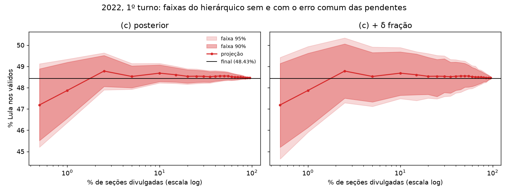

# 06 — 1º turno e erro comum das pendentes

Esta fase faz duas coisas. Leva o projetor ao 1º turno de 2018 e 2022, o que dobra o número de noites de teste. E acrescenta ao modelo hierárquico um erro comum a todas as seções pendentes, para ver se assim a faixa posterior passa a cobrir o que promete sem uma recalibração externa.

Gerado por `notebooks/06a_primeiro_turno.py` (backtest, ~1 h) e `notebooks/06_melhorias.py` (tabelas).

## Os dados do 1º turno batem com o oficial

Os BUs do 1º turno foram baixados com o mesmo pipeline, só com as linhas de Presidente. Seções: 2014: 428.854, 2018: 454.450, 2022: 472.028. No 1º turno, os válidos incluem todos os candidatos, e o alvo continua sendo o % de um candidato nos válidos.

|   ano | campo      |   BU agregado |     oficial |   diferença |
|------:|:-----------|--------------:|------------:|------------:|
|  2014 | pt         |    43,267,668 |  43,267,668 |           0 |
|  2014 | adversario |    34,897,211 |  34,897,211 |           0 |
|  2014 | validos    |   104,023,802 | 104,023,802 |           0 |
|  2018 | pt         |    31,342,005 |  31,342,005 |           0 |
|  2018 | adversario |    49,276,990 |  49,276,990 |           0 |
|  2018 | validos    |   107,051,419 | 107,050,673 |         746 |
|  2022 | pt         |    57,259,504 |  57,259,504 |           0 |
|  2022 | adversario |    51,072,345 |  51,072,345 |           0 |
|  2022 | validos    |   118,229,719 | 118,229,719 |           0 |

PT e principal adversário batem voto a voto nos três anos. Os válidos de 2018 ficam 746 votos acima da totalização do TSE (0,0007%), e a diferença está toda nos demais candidatos. O efeito no % de qualquer candidato é menor que 0,001 ponto.

Dois CSVs de 2018 têm aspas sem escape no nome de candidatos a deputado estadual, o que quebrava o parser. A extração agora guarda só as linhas de Presidente. Reprocessado com essa regra, o 2º turno de 2022 saiu idêntico ao parquet anterior.

Resultado final de cada alvo (% nos válidos):

| alvo       |   2018 |   2022 |
|:-----------|-------:|-------:|
| adversario | 46.031 | 43.198 |
| pt         | 29.278 | 48.431 |

As noites são 2022 1T ← 2018 1T e 2018 1T ← 2014 1T. A ordem de chegada de 2022 é a observada (`DT_BU_RECEBIDO`). A de 2018 é simulada a partir do 1º turno de 2022, como no 2º turno. O alvo "adversário" é Bolsonaro nos dois anos. Em 2018, o histórico dele é o voto de Aécio (PSDB) em 2014, a única referência anti-PT disponível. É uma referência fraca.

## Erro dos modelos no 1º turno

Erro absoluto em pontos percentuais nos 22 pontos da grade (0,5% a 95% das seções). "Tempo até cravar" é o % de seções a partir do qual o erro fica abaixo de 0,5 ponto até o fim.

### % do PT

|   ano | modelo                      |   erro médio |   erro até 2,5% |   erro 5–95% |   tempo até cravar |
|------:|:----------------------------|-------------:|----------------:|-------------:|-------------------:|
|  2018 | Apurado                     |        4.689 |           9.671 |        3.903 |              nan   |
|  2018 | SwingUniformeUF             |        0.249 |           0.595 |        0.195 |                5   |
|  2018 | SwingCamadasInterceptoPorte |        0.495 |           0.806 |        0.445 |               40   |
|  2018 | SwingHierarquico-t          |        0.513 |           1.495 |        0.357 |               40   |
|  2022 | Apurado                     |        4.105 |           6.94  |        3.657 |              nan   |
|  2022 | SwingUniformeUF             |        0.746 |           2.014 |        0.546 |               70   |
|  2022 | SwingCamadasInterceptoPorte |        0.43  |           1.965 |        0.187 |               15   |
|  2022 | SwingHierarquico-t          |        0.182 |           0.719 |        0.097 |                2.5 |

### % do principal adversário

|   ano | modelo                      |   erro médio |   erro até 2,5% |   erro 5–95% |   tempo até cravar |
|------:|:----------------------------|-------------:|----------------:|-------------:|-------------------:|
|  2018 | Apurado                     |        4.109 |           7.585 |        3.56  |              nan   |
|  2018 | SwingUniformeUF             |        0.792 |           2.899 |        0.459 |               30   |
|  2018 | SwingCamadasInterceptoPorte |        0.357 |           1.581 |        0.163 |                2.5 |
|  2018 | SwingHierarquico-t          |        0.572 |           2.629 |        0.247 |                5   |
|  2022 | Apurado                     |        3.519 |           5.062 |        3.275 |              nan   |
|  2022 | SwingUniformeUF             |        0.264 |           0.933 |        0.158 |                1   |
|  2022 | SwingCamadasInterceptoPorte |        0.242 |           1.481 |        0.047 |                2.5 |
|  2022 | SwingHierarquico-t          |        0.137 |           0.414 |        0.094 |                1   |

Em 2022, o hierárquico-t continua o melhor nos dois alvos. Com 2,5% das seções, ele já erra menos de 0,5 ponto para Lula e não sai mais disso. Em 2018 a ordem se inverte. Para Haddad, o swing por UF simples erra 0,25 em média e o hierárquico 0,51, sobretudo no começo (1,5 ponto até 2,5% das seções). A troca de Dilma por Haddad e a entrada de Bolsonaro mudaram o voto do PT de um jeito pouco ligado às covariáveis do modelo (voto anterior, porte, capital). Com poucos locais, o modelo mais flexível acompanha o ruído das primeiras seções. Para Bolsonaro em 2018, as camadas ganham, e o swing por UF sofre com a referência fraca de Aécio.

Nenhum modelo vence em todas as noites. Contando o 2º turno, o hierárquico tem o menor erro nas duas noites de 2022. Nas de 2018, perde para modelos mais simples: as camadas no 2º turno (0,22 contra 0,37) e o swing por UF no 1º. São as noites com ordem simulada e com a eleição anterior menos parecida.

## Erro comum às pendentes

O hierárquico trata o erro de cada local pendente como independente. Com milhares de locais, esse erro some na soma, e a faixa do total fica estreita demais. Na noite real, o que falta difere do que já chegou de um jeito que as covariáveis não capturam, e esse erro é comum a todas as pendentes. O modelo ganhou um termo

    delta ~ Normal(0, c × h),   somado ao swing de todos os locais pendentes,

que desloca o % final em `fração pendente × delta`. Foram testadas duas escalas: h = 1, em que o efeito cresce só com a fração que falta, e h = distância de variação total entre a composição UF × capital/interior dos válidos esperados divulgados e a dos pendentes.

O swing das pendentes não é observado durante a noite, então `c` não pode ser aprendido nela. Ele é calibrado por máxima verossimilhança nos erros de outras noites: erro ~ Normal(0, variância posterior + (fração · c · h)²). A avaliação é leave-one-night-out nas quatro noites do PT. Cada noite usa `c`, ou o multiplicador de (e), calibrado nas outras três. Para o adversário, a calibração usa as noites do PT de outras eleições.

Métodos comparados:

- (c) posterior do hierárquico-t, como sai do modelo;
- (c) + δ, com as duas escalas;
- (e) posterior recalibrada: desvio multiplicado pelo quantil conformal de |erro|/desvio das outras noites (o método adotado na fase 4).

### Quatro noites do PT juntas

| metodo            | cobertura 90%   |   largura 90% |   winkler 90% | cobertura 95%   |   largura 95% |   winkler 95% |
|:------------------|:----------------|--------------:|--------------:|:----------------|--------------:|--------------:|
| (c) posterior     | 41%             |          0.62 |          2.5  | 42%             |          0.73 |          3.62 |
| (c) + δ fração    | 75%             |          1.27 |          2.2  | 77%             |          1.51 |          2.49 |
| (c) + δ distância | 74%             |          1.49 |          2.23 | 78%             |          1.76 |          2.73 |
| (e) recalibrada   | 82%             |          2.17 |          2.55 | 82%             |          3.47 |          4.16 |

### Por noite

| noite      | metodo            | cobertura 90%   |   largura 90% |   winkler 90% | cobertura 95%   |   largura 95% |   winkler 95% |
|:-----------|:------------------|:----------------|--------------:|--------------:|:----------------|--------------:|--------------:|
| 2018 1T PT | (c) + δ distância | 14%             |          0.87 |          3.7  | 23%             |          1.03 |          4.88 |
| 2018 1T PT | (c) + δ fração    | 14%             |          0.83 |          3.81 | 18%             |          0.99 |          4.71 |
| 2018 1T PT | (c) posterior     | 9%              |          0.62 |          5.39 | 9%              |          0.74 |          8.61 |
| 2018 1T PT | (e) recalibrada   | 27%             |          1.22 |          2.76 | 27%             |          1.28 |          4.01 |
| 2018 2T PT | (c) + δ distância | 82%             |          1.76 |          1.89 | 91%             |          2.07 |          2.11 |
| 2018 2T PT | (c) + δ fração    | 86%             |          1.47 |          2.21 | 91%             |          1.77 |          1.98 |
| 2018 2T PT | (c) posterior     | 45%             |          0.76 |          2.81 | 45%             |          0.9  |          3.63 |
| 2018 2T PT | (e) recalibrada   | 100%            |          3.75 |          3.75 | 100%            |          6.35 |          6.35 |
| 2022 1T PT | (c) + δ distância | 100%            |          1.59 |          1.59 | 100%            |          1.9  |          1.9  |
| 2022 1T PT | (c) + δ fração    | 100%            |          1.43 |          1.43 | 100%            |          1.71 |          1.71 |
| 2022 1T PT | (c) posterior     | 91%             |          0.69 |          0.71 | 95%             |          0.8  |          0.82 |
| 2022 1T PT | (e) recalibrada   | 100%            |          2.27 |          2.27 | 100%            |          3.84 |          3.84 |
| 2022 2T PT | (c) + δ distância | 100%            |          1.74 |          1.74 | 100%            |          2.04 |          2.04 |
| 2022 2T PT | (c) + δ fração    | 100%            |          1.34 |          1.34 | 100%            |          1.59 |          1.59 |
| 2022 2T PT | (c) posterior     | 18%             |          0.43 |          1.1  | 18%             |          0.5  |          1.43 |
| 2022 2T PT | (e) recalibrada   | 100%            |          1.43 |          1.43 | 100%            |          2.42 |          2.42 |

### Parâmetro calibrado em cada noite

`c` em pontos de swing; para (e), o multiplicador do desvio a 90%.

| noite              |   (c) + δ fração |   (c) + δ distância |   (e) recalibrada |
|:-------------------|-----------------:|--------------------:|------------------:|
| 2018 1T PT         |             0.26 |                0.66 |              3.24 |
| 2018 1T adversário |             0.26 |                0.66 |              3.24 |
| 2018 2T PT         |             0.58 |                1.46 |              5.44 |
| 2022 1T PT         |             0.64 |                1.63 |              5.44 |
| 2022 1T adversário |             0.64 |                1.63 |              5.44 |
| 2022 2T PT         |             0.66 |                1.67 |              5.44 |

Com as quatro noites, `c` = 0,56 ponto de swing na escala de fração e 1,42 na de distância. Na escala de fração, isso dá um desvio de cerca de 0,5 ponto no total com 5% das seções divulgadas e de 0,28 ponto na metade da apuração.

### Alvo adversário

| noite              | metodo            | cobertura 90%   |   largura 90% |   winkler 90% | cobertura 95%   |   largura 95% |   winkler 95% |
|:-------------------|:------------------|:----------------|--------------:|--------------:|:----------------|--------------:|--------------:|
| 2018 1T adversário | (c) + δ distância | 32%             |          0.94 |          4.72 | 45%             |          1.11 |          6.68 |
| 2018 1T adversário | (c) + δ fração    | 41%             |          0.91 |          4.72 | 50%             |          1.08 |          6.76 |
| 2018 1T adversário | (c) posterior     | 14%             |          0.69 |          5.85 | 23%             |          0.81 |          9.34 |
| 2018 1T adversário | (e) recalibrada   | 36%             |          1.36 |          2.68 | 41%             |          1.42 |          3.74 |
| 2022 1T adversário | (c) + δ distância | 100%            |          1.45 |          1.45 | 100%            |          1.72 |          1.72 |
| 2022 1T adversário | (c) + δ fração    | 100%            |          1.26 |          1.26 | 100%            |          1.51 |          1.51 |
| 2022 1T adversário | (c) posterior     | 32%             |          0.3  |          1.06 | 41%             |          0.36 |          1.73 |
| 2022 1T adversário | (e) recalibrada   | 68%             |          1    |          1.17 | 86%             |          1.7  |          1.73 |

## O que mudou

- **O δ ajuda, mas não basta.** A cobertura de 90% da posterior sobe de 41% para 75% nas quatro noites, e o interval score cai de 2,50 para 2,20, o melhor entre os métodos. Em três das quatro noites, (c) + δ cobre entre 86% e 100%. A resposta à pergunta da fase é não: a faixa ainda não chega perto do nominal em toda noite.
- **A falha é uma noite só.** Em 2018 1T, a cobertura fica em 14%. As outras três noites ensinam um `c` pequeno (0,26), porque nelas o hierárquico errou pouco. Nenhum método calibrado em outras noites cobre bem uma noite fora do padrão. A recalibração (e) também cai para 27% ali.
- **A distância de composição não acrescenta.** Ela dá cobertura parecida com faixas mais largas. A fração que falta já carrega o que importa. O que distingue as noites difíceis não é a composição UF × capital das pendentes, que o modelo já vê.
- **(e) cobre mais no agregado (82%), mas a um custo alto.** Suas faixas são quase o dobro das de (c) + δ, com interval score pior. Em 2022 2T, (e) e (c) + δ cobrem 100%; a faixa de (c) + δ é mais estreita (1,34 contra 1,43 ponto).

Na prática, (c) + δ na escala de fração substitui bem a recalibração (e). Ela é parte do modelo, cresce e encolhe com a fração que falta e precisa de um parâmetro só. O replay continua com (e), calibrada no 2º turno. Trocar exige reexportar `docs/data`.

## Limites

- **Poucas noites.** São quatro noites, e os 22 pontos de uma noite são muito correlacionados. A calibração de `c` se apoia em quatro observações quase independentes. Uma noite como 2018 1T pesa muito.
- **Ordem simulada em 2018.** A ordem de 2018 é a de 2022 transposta, e o erro do começo da noite depende dela.
- **Histórico fraco do adversário em 2018.** O histórico do adversário em 2018 é o voto de Aécio, e as faixas desse alvo herdam essa fraqueza.
