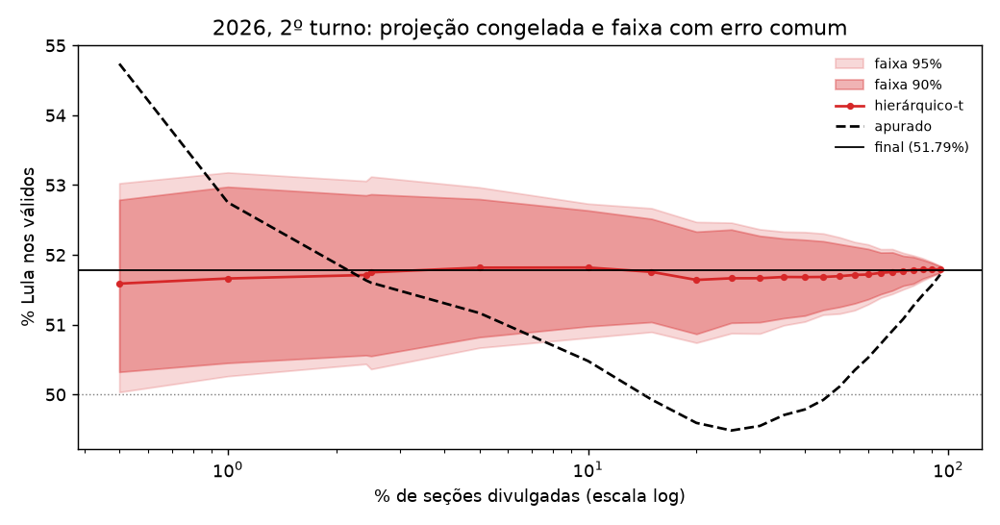

# 07 — Eleição de 2026, fora da amostra

Até aqui, todo resultado vinha de eleições em que os modelos foram desenvolvidos. Em 2026, nada foi reescolhido olhando a noite. Os modelos e hiperparâmetros são os das fases 2 a 4. O `c` do erro comum e o multiplicador da faixa (e) foram calibrados nas noites de 2018 e 2022 (fases 6 e 7). É o teste mais limpo do projeto.

Gerado por `notebooks/07a_eleicao_2026.py` (backtest, ~1 h) e `notebooks/07_eleicao_2026.py` (tabelas).

## Os dados de 2026

Os boletins de urna estão no Portal de Dados Abertos do TSE (`resultados-2026-boletim-de-urna`). O pacote CKAN lista 27 UFs no 2º turno. O zip de Roraima falta na lista, mas está no CDN com o mesmo carimbo de geração e com `.sha512`. O ingest agora completa UFs nessa situação. O formato mudou: as datas vêm em ISO (`2026-10-25 19:42:19`) e vários números vêm sem aspas.

| turno   |   seções |   UFs |       Lula |   Flávio Bolsonaro |     válidos |   % Lula |   % Flávio |
|:--------|---------:|------:|-----------:|-------------------:|------------:|---------:|-----------:|
| 1º      |  499,206 |    28 | 53,879,538 |         56,104,503 | 119,306,034 |   45.161 |     47.026 |
| 2º      |  499,205 |    28 | 64,256,232 |         59,826,041 | 124,082,273 |   51.785 |     48.215 |

Os percentuais do 1º turno batem com o resultado final publicado (Lula 45,16%, Flávio Bolsonaro 47,03%). O adversário é o número 22 (PL) nos dois turnos.

`DT_BU_RECEBIDO` existe em todas as seções (0 sem valor) e está em hora de Brasília. No 2º turno, o Acre encerrou às 15:01 locais (17:01 de Brasília) e o primeiro BU chegou às 17:05. Primeiro recebimento por UF: AC 17:05, AL 17:05, AM 17:05, AP 17:05, BA 17:05, CE 17:05, DF 17:05, ES 17:06, GO 17:05, MA 17:05, MG 17:05, MS 17:06, MT 17:05, PA 17:05, PB 17:05, PE 17:07, PI 17:07, PR 17:05, RJ 19:03, RN 17:06, RO 17:05, RR 17:05, RS 17:06, SC 17:05, SE 19:34, SP 19:03, TO 17:05, ZZ 17:05.

A ordem de 2026 foi bem mais enviesada que a de 2022. São Paulo e Rio só começam a chegar às 19:03, e as primeiras seções vêm sobretudo do Paraná, do Pará e do Distrito Federal. Com 0,5% das seções no 2º turno, o apurado dava 54,7% a Lula, que terminou com 51,8%.

## Conferência com a noite real

A ordem vem do `DT_BU_RECEBIDO`, e a curva reconstruída bate com a divulgação pública. No 2º turno, a divulgação do TSE foi suspensa com cerca de 0,25% das urnas, quando a votação foi prorrogada até as 19h, e retomada por volta das 19h. Nos dados, 1.868 seções (776 do exterior) têm recebimento entre 17h05 e 17h07. A seção seguinte só chega às 19h03.

Parcial de Lula no mesmo % de urnas apuradas: a série do g1 ("Compare evolução da apuração do 2º turno de 2026 com 2022", fonte TSE) contra o apurado reconstruído aqui.

| % das urnas | g1 | este replay | horário aqui |
|---|---|---|---|
| 10% | 50,46 | 50,48 | 19h38 |
| 20% | 49,59 | 49,59 | 19h56 |
| 30% | 49,53 | 49,55 | 20h07 |
| 40% | 49,80 | 49,79 | 20h17 |
| 50% | 50,14 | 50,12 | 20h26 |
| 60% | 50,55 | 50,53 | 20h34 |
| 70% | 50,92 | 50,91 | 20h43 |
| 80% | 51,27 | 51,27 | 20h52 |
| 90% | 51,58 | 51,56 | 21h01 |
| 100% | 51,8 | 51,79 | — |

Horários publicados pela imprensa (Terra e Mixvale) contra o horário em que o replay atinge o mesmo %: 10,40% às 19h39 (aqui 19h38); cerca de 13,5% às 19h45, com Flávio na frente (aqui 19h44); empate e Lula retomando com 47,24% entre 20h20 e 20h25 (aqui 20h22–20h23); 94,93% e Lula 51,72% às 21h06 (aqui 21h05 e 51,72%). A única defasagem é a retomada: a imprensa deu 1,67% às 19h00, e o replay chega a esse ponto às 19h12, porque os BUs recebidos durante a pausa entraram em bloco. O backtest usa o % de seções como relógio, então a pausa não muda nenhuma projeção nem conclusão.

## Erro dos modelos congelados

Erro absoluto (p.p.) nos 22 pontos da grade, de 0,5% a 95% das seções.

| turno   | alvo       | modelo                      |   erro médio |   erro até 2,5% |   erro 5–95% |   tempo até cravar |
|:--------|:-----------|:----------------------------|-------------:|----------------:|-------------:|-------------------:|
| 1º      | adversario | Apurado                     |        2.682 |           1.754 |        2.829 |              nan   |
| 1º      | adversario | SwingUniformeUF             |        0.177 |           0.67  |        0.099 |                2.5 |
| 1º      | adversario | SwingCamadasInterceptoPorte |        0.093 |           0.242 |        0.069 |                0.5 |
| 1º      | adversario | SwingHierarquico-t          |        0.121 |           0.562 |        0.051 |                5   |
| 1º      | pt         | Apurado                     |        2.99  |           1.973 |        3.151 |              nan   |
| 1º      | pt         | SwingUniformeUF             |        0.332 |           1.202 |        0.195 |                2.5 |
| 1º      | pt         | SwingCamadasInterceptoPorte |        0.18  |           0.408 |        0.144 |               10   |
| 1º      | pt         | SwingHierarquico-t          |        0.167 |           0.829 |        0.063 |                5   |
| 2º      | pt         | Apurado                     |        1.305 |           1.368 |        1.295 |               85   |
| 2º      | pt         | SwingUniformeUF             |        0.183 |           0.42  |        0.145 |                1   |
| 2º      | pt         | SwingCamadasInterceptoPorte |        0.115 |           0.376 |        0.073 |                1   |
| 2º      | pt         | SwingHierarquico-t          |        0.067 |           0.118 |        0.059 |                0.5 |

Entre 19h44 e 20h23 do 2º turno, de 14% a 47% das seções, o apurado mostrou Flávio na frente; o mínimo de Lula foi 49,5%. Na noite inteira, a projeção do hierárquico ficou entre 51,6% e 51,8%, e o limite inferior da faixa de 90% nunca desceu de 50,3%. No 2º turno, o hierárquico-t erra 0,07 ponto em média e fica abaixo de 0,5 ponto desde 0,5% das seções. É o melhor resultado do projeto em qualquer noite. No 1º turno, hierárquico e camadas empatam no alvo PT (0,17 e 0,18). Para Flávio, as camadas ganham (0,09 contra 0,12). O hierárquico erra mais no começo da noite (0,8 ponto até 2,5% para Lula) e menos depois de 5%.

## Faixas congeladas

Quatro faixas, todas fixadas antes de 2026:

- (c) posterior do hierárquico-t, como sai do modelo;
- (c) + δ fração, com `c` = 0,56 das quatro noites do PT (fase 6);
- (e) recalibrada, com multiplicadores 5,04 (90%) e 7,10 (95%) das mesmas quatro noites;
- (c) + δ ruído, com `c` = 2,88 das 30 noites presidenciais e de governador (fase 7). É a faixa que o replay mostra.

| noite              | metodo                 | cobertura 90%   |   largura 90% |   winkler 90% | cobertura 95%   |   largura 95% |   winkler 95% |
|:-------------------|:-----------------------|:----------------|--------------:|--------------:|:----------------|--------------:|--------------:|
| 2026 1T PT         | (c) + δ fração         | 100%            |          1.12 |          1.12 | 100%            |          1.32 |          1.32 |
| 2026 1T PT         | (c) + δ ruído (fase 7) | 100%            |          1.41 |          1.41 | 100%            |          1.67 |          1.67 |
| 2026 1T PT         | (c) posterior          | 64%             |          0.29 |          1.06 | 73%             |          0.34 |          1.42 |
| 2026 1T PT         | (e) recalibrada        | 91%             |          0.88 |          0.9  | 95%             |          1.24 |          1.26 |
| 2026 1T adversário | (c) + δ fração         | 100%            |          1.1  |          1.1  | 100%            |          1.3  |          1.3  |
| 2026 1T adversário | (c) + δ ruído (fase 7) | 100%            |          1.27 |          1.27 | 100%            |          1.49 |          1.49 |
| 2026 1T adversário | (c) posterior          | 77%             |          0.24 |          0.5  | 82%             |          0.28 |          0.57 |
| 2026 1T adversário | (e) recalibrada        | 95%             |          0.74 |          0.75 | 100%            |          1.05 |          1.05 |
| 2026 2T PT         | (c) + δ fração         | 100%            |          1.07 |          1.07 | 100%            |          1.26 |          1.26 |
| 2026 2T PT         | (c) + δ ruído (fase 7) | 100%            |          1.12 |          1.12 | 100%            |          1.32 |          1.32 |
| 2026 2T PT         | (c) posterior          | 45%             |          0.23 |          0.65 | 45%             |          0.27 |          0.94 |
| 2026 2T PT         | (e) recalibrada        | 100%            |          0.69 |          0.69 | 100%            |          0.98 |          0.98 |

A posterior pura volta a cobrir menos que o prometido: 45% a 77% na faixa de 90%. As três faixas corrigidas cobrem de 91% a 100% nas três noites. Entre as faixas corrigidas, a recalibração (e) teve o menor interval score em 2026, com faixas de 0,7 a 0,9 ponto. Em duas noites, a posterior pura pontuou ainda um pouco melhor, porque os erros foram pequenos e ficaram perto da faixa estreita. As faixas com δ cobriram tudo, com 1,1 a 1,4 ponto. Foi uma noite fácil para o modelo, e as faixas calibradas em noites difíceis (2018 1T e os governadores) erraram para o lado seguro.

A escolha do replay continua sendo (c) + δ ruído. Nas 34 noites avaliadas (30 de calibração e as 3 de 2026), ela nunca cobre menos de 90% numa noite presidencial. A (e) cai para 27% em 2018 1T, porque um multiplicador fixo não distingue uma noite difícil de uma fácil. O custo é uma faixa mais larga quando a noite é fácil, como 2026.

## Comparação com o modelo de Rodrigo Mahlmeister

Os números do modelo de Rodrigo são os públicos, como repassados no briefing do projeto. A coluna "este projeto" mostra o hierárquico-t congelado, com a faixa de 95% de (c) + δ ruído. O instante é o mesmo, medido em % das seções divulgadas. Nos dois turnos, o relógio deste projeto chega a esse ponto entre 17h29 (1º turno) e 19h19 (2º turno).

| turno   | candidato        |   % seções |   apurado | Rodrigo          | este projeto        |   final |
|:--------|:-----------------|-----------:|----------:|:-----------------|:--------------------|--------:|
| 1º      | Flávio Bolsonaro |       2.2  |     49.34 | 47,01            | 46.51 (45.13–47.93) |   47.03 |
| 1º      | Lula             |       2.2  |     42.1  | 45,50            | 45.90 (44.34–47.52) |   45.16 |
| 2º      | Lula             |       2.42 |     51.64 | 51,6 (50,8–52,2) | 51.71 (50.44–53.06) |   51.79 |

- **No 2º turno**, as duas projeções ficam a 0,2 ponto ou menos do final. A deste projeto chega mais perto (51,71 contra 51,6, com final 51,79). As duas faixas cobrem o resultado; a daqui é mais larga.
- **No 1º turno, com 2,2% das seções**, o modelo de Rodrigo acertou melhor: 0,02 ponto de erro em Flávio e 0,34 em Lula, contra 0,52 e 0,74 do hierárquico. O modelo em camadas daqui, mais parecido com o dele, projetava Lula 45,48 e Flávio 46,73 nesse instante. O valor de Lula é praticamente o dele (45,50). A diferença em Flávio é compatível com o ponto de partida do modelo de Rodrigo: segundo a reportagem da NeoFeed, ele partiu da pesquisa Quaest e somou dois pontos a Flávio. Este projeto não usa pesquisa nenhuma.
- **Uma comparação de um instante só diz pouco.** O modelo de Rodrigo não publicou faixas no 1º turno nem um backtest, então a comparação para no ponto. Ao longo da noite inteira, o hierárquico daqui erra 0,05 a 0,06 ponto depois de 5% das seções nos dois turnos.

## Limites

- **Três noites de teste.** São duas datas, com os mesmos dois candidatos, numa eleição polarizada como a de 2022. É o cenário mais favorável ao swing.
- **Números de Rodrigo não auditados.** Os números do modelo de Rodrigo não foram auditados aqui; vêm da reportagem e do briefing.
- **Grade de pontos.** O instante de comparação foi incluído na grade porque era o publicado; a grade em si não foi ajustada a 2026.
