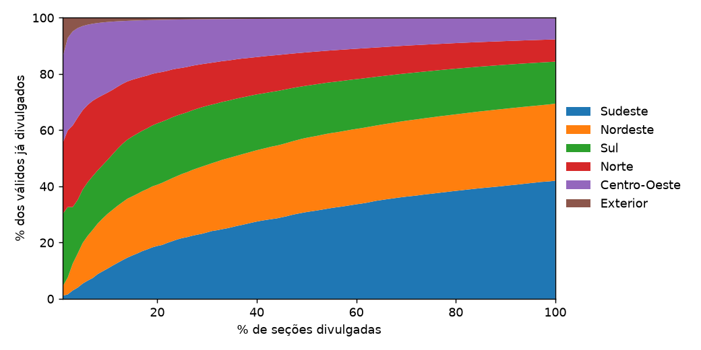
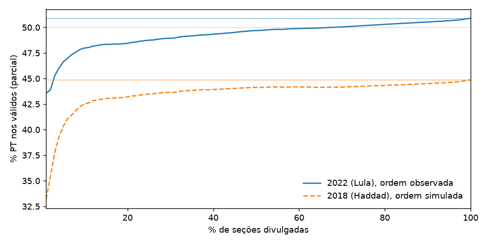
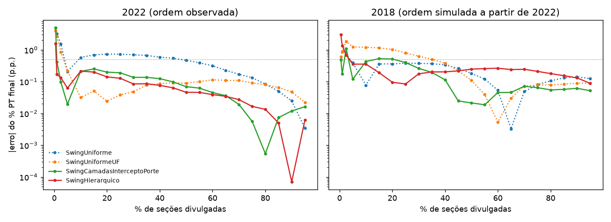

# Quem chega primeiro engana: quão honestas são as projeções de apuração no Brasil

Entre 19h44 e 20h23 de 25 de outubro de 2026, com 14% a 47% das seções divulgadas, o apurado do 2º turno mostrou Flávio Bolsonaro na frente. Lula terminou com 51,79%. Em 2022 foi igual: às 18h, com 29% das seções, Lula tinha 48,9%, e terminou com 50,90%. Não houve virada em nenhuma das duas noites. As seções não chegam em ordem aleatória, e o apurado é uma média de quem chegou primeiro.

Projetar o resultado a partir da parcial virou prática em noites eleitorais, no Brasil e fora dele. A pergunta deste projeto é: quão boas são essas projeções em tempo real, e as faixas de incerteza delas são honestas? Uma faixa honesta é a que, quando promete conter o resultado 90% das vezes, contém.

O modelo de swing por local de votação em camadas, do tipo usado por Rodrigo Mahlmeister em 2026, pelo Washington Post e pelo New York Times, entra aqui como uma das referências comparadas, não como o objetivo. As contribuições próprias são cinco:

1. **Backtest sem vazamento** em seis noites presidenciais (1º e 2º turnos de 2018, 2022 e 2026, com históricos desde 2014) e 26 noites de governador. A ordem de chegada é reconstruída pelo `DT_BU_RECEBIDO`, com tratamento de fuso.
2. **Pooling aprendido contra pesos escolhidos à mão**: um modelo hierárquico bayesiano com Student-t, mostrando onde ele ganha e onde perde.
3. **Auditoria das faixas.** As que saem só do modelo cobrem de 18% a 45% quando prometem 90%. Um termo de erro comum às seções pendentes, calibrado em outras noites, corrige isso.
4. **Nenhuma pesquisa eleitoral.** Só boletins de urna e a eleição anterior.
5. **Teste congelado em 2026**, comparado com os números públicos de Rodrigo.

## O problema: a ordem da apuração não é aleatória

Os boletins de urna (BU) de 2022 trazem, para cada seção, o horário em que o boletim chegou ao sistema de totalização (`DT_BU_RECEBIDO`). Com esse campo dá para reconstruir a noite seção por seção. A primeira coisa que aparece é que a ordem tem geografia.

Até 10% das seções divulgadas, o Centro-Oeste pesava 3,4 vezes mais do que pesa no total, e o Norte 3,0 vezes. O Sudeste, com 42% dos votos válidos do país, era só 10,7% do que tinha sido apurado. As capitais chegaram adiantadas (1,9 vez o seu peso), e o interior atrasado. Como Lula teve 69% dos válidos no Nordeste e 46% no Sudeste, essa ordem decide para onde a parcial pende.

Com 5% das seções, a parcial de Lula estava 4,3 pontos abaixo do resultado final. Com 50%, ainda 1,2 ponto abaixo. Um bom projetor precisa corrigir esse viés olhando para as seções que faltam, e não só para as que chegaram.

## Inspiração

A forma do modelo e da apresentação vem do modelo de projeção de apuração de Rodrigo Mahlmeister ([@ro_mahl](https://x.com/ro_mahl)), publicado nas eleições de 2026 e descrito pela [reportagem da NeoFeed](https://neofeed.com.br/finde/como-um-pesquisador-brasileiro-criou-um-algoritmo-que-simulou-e-acertou-o-resultado-do-1o-turno/). Duas ideias vieram de lá: projetar o swing de cada local de votação contra a eleição anterior e mostrar, para cada candidato, a projeção, a faixa e o apurado lado a lado. Este projeto é uma reimplementação independente, feita a partir da descrição pública do método; o código de Rodrigo é privado e não foi usado. As faixas conformais seguem a linha do modelo de noite eleitoral do Washington Post (elex-live-model; Cherian, Bronner e Candès, 2024). Os erros e as escolhas daqui são meus, não dele.

## Dados

Tudo vem do portal de dados abertos do TSE: os boletins de urna por seção de 2014 a 2026, nos dois turnos, para as 27 UFs e o exterior. Depois de agregar a votação para presidente (ou governador), sobra uma linha por seção, com município, zona, local de votação, aptos, comparecimento e votos. Os votos do PT e do adversário batem voto a voto com o resultado oficial; no 2º turno de 2022, por exemplo, Lula 60.345.999 e Bolsonaro 58.206.354.

Há três cuidados que não aparecem à primeira vista.

- **Fusos.** `DT_ENCERRAMENTO` está em hora local (o Acre fecha às 15h); `DT_BU_RECEBIDO`, em hora de Brasília. Boletins recebidos antes das 17h só entram na divulgação a partir daí.
- **2018 não tem horário de recebimento.** O BU de 2018 traz só abertura e encerramento. A ordem de 2018 é, portanto, simulada: cada seção herda a distribuição de chegada do mesmo local de votação em 2022 e, na falta dele, da zona, do município ou da UF. O backtest de 2018 mede o modelo sob a ordem de 2022, não sob a ordem real daquela noite.
- **Locais mudam de número.** Os locais foram pareados entre eleições por município + zona + local: 94,3% com par direto de 2018 para 2022, o resto por rezoneamento, zona ou município.

## Um backtest que não deixa o futuro vazar

O simulador percorre uma grade de 22 instantes do relógio (de 0,5% a 95% das seções). Em cada instante, o modelo recebe dois conjuntos.

- As seções **divulgadas**, com tudo, inclusive os votos da noite.
- As seções **pendentes**, só com identificadores, eleitores aptos e o resultado da eleição anterior no local equivalente. Votos, comparecimento, horários e a própria posição no relógio ficam de fora.

Um teste automatizado garante isso: com os votos das seções futuras trocados por lixo, a projeção precisa sair idêntica. As métricas são o erro absoluto do % do PT final em cada instante, a média desses erros e o "tempo até cravar": o primeiro instante a partir do qual o erro fica abaixo de 0,5 ponto e não sai mais.

O desenvolvimento usou 2022 com histórico de 2018 e 2018 com histórico de 2014. Todo hiperparâmetro foi escolhido em 2018 e só depois aplicado em 2022; em 2026, nada foi reescolhido.

## A progressão de modelos

**Baselines.** O primeiro modelo é o próprio apurado. O segundo aplica às pendentes o swing médio das seções divulgadas contra a eleição anterior (swing uniforme). O terceiro faz o mesmo com um swing por UF.

**Regressões.** A fase 2 ajusta, a cada instante, uma regressão ponderada do swing por local contra o voto anterior, o tamanho do município e uma dummy de capital. Sozinha, ela não enxerga que o swing do Sudeste (+10,8 pontos) foi muito maior que o do Nordeste (−0,3). O que funcionou foi manter a regressão no nível nacional e estimar só deslocamentos por região, UF e UF × capital/interior, cada um encolhido para o nível de cima com peso n/(n + k). O k = 30 foi escolhido em 2018.

**Hierárquico bayesiano.** A fase 3 troca o k escolhido à mão por pooling aprendido. É o mesmo swing por local, com efeitos de região, UF e UF × capital/interior, e desvios entre grupos estimados pelos dados, em PyMC com inferência variacional. A fase 4 trocou a verossimilhança normal por uma Student-t (ν aprendido ≈ 3 a 4), mais robusta a locais com swing extremo.

| Modelo | 2022: erro médio | 2022: fica abaixo de 0,5 a partir de | 2018: erro médio |
|---|---|---|---|
| Apurado | 2,19 | 85% | 2,47 |
| Swing uniforme | 0,77 | 50% | 0,27 |
| Swing por UF | 0,41 | 5% | 0,51 |
| Regressão nacional | 0,70 | 45% | 0,46 |
| Camadas com deslocamentos e UF × capital | 0,32 | 1% | **0,22** |
| Hierárquico (normal) | 0,15 | 1% | 0,41 |
| **Hierárquico (Student-t)** | **0,14** | **0,5%** | 0,37 |

*Erros em pontos percentuais do % do PT nos válidos, médias sobre os 22 instantes.*

Em 2022, a Student-t erra 0,4 ponto com 0,5% das seções e não passa de 0,3 depois. Em 2018, o modelo em camadas vence. Parte da explicação é que o k dele foi escolhido justamente em 2018. A outra está nos dados: o swing de 2014 para 2018 foi duas vezes mais disperso que o de 2018 para 2022, e Bolsonaro cresceu muito mais nas cidades grandes, que chegam cedo.

## As faixas, e por que as de modelo falham

A fase 4 comparou cinco formas de construir faixas de 90% e 95%.

- (a) Erro de previsão analítico do modelo em camadas.
- (b) Bootstrap preditivo por local.
- (c) Posterior do hierárquico.
- (d) Conformal: o quantil do erro do modelo pontual na outra eleição, por faixa do relógio.
- (e) Posterior recalibrada: o desvio de (c) multiplicado pelo quantil de |erro|/desvio na outra eleição.

| Método | 2022: cobertura 90% | 2022: Winkler | 2018: cobertura 90% | 2018: Winkler |
|---|---|---|---|---|
| (a) analítico | 27% | 5,00 | 36% | 1,93 |
| (b) bootstrap | 18% | 5,34 | 41% | 4,23 |
| (c) posterior | 18% | 1,10 | 45% | 2,81 |
| (d) conformal | 95% | 4,18 | 64% | 2,49 |
| **(e) posterior recalibrada** | **100%** | **1,10** | **86%** | **2,34** |

As faixas que vêm só do modelo cobrem de 18% a 45% quando prometem 90%. Isso não pede ajuste fino; mostra que falta algo no modelo. O diagnóstico é o mesmo para (a), (b) e (c). Os três tratam o erro de cada local pendente como independente, então a incerteza total encolhe com a raiz do número de locais que faltam. O erro real tem um componente comum: as seções pendentes diferem das divulgadas de um jeito que as covariáveis não capturam, e esse desvio não se dilui.

O conformal puro (d) resolve 2022, mas falha em 2018, porque cada direção é calibrada por uma única noite. A posterior recalibrada (e), com a forma da faixa vinda do modelo e a escala vinda da outra eleição, teve o menor interval score nos dois anos.

## O erro comum, e noites para calibrá-lo

O hierárquico ganhou o termo que faltava: um erro `delta` somado ao swing de todas as pendentes, que desloca o total em proporção à fração que falta. Esse erro não é observável durante a noite, então sua escala é calibrada em outras noites, deixando de fora a data avaliada.

Com só as quatro noites presidenciais de 2018 e 2022 (1º e 2º turnos; no 1º, o alvo é o % do candidato nos válidos de todos), a cobertura de 90% subiu de 41% para 75%. Mas 2018 1T ficou em 14%: a troca de Dilma por Haddad mudou o voto do PT de um jeito que 2014 explica mal, e as outras noites não ensinavam um erro desse tamanho.

As 26 noites de 2º turno de governador de 2018 e 2022 resolveram isso. O histórico delas é o 1º turno de governador do mesmo ano, e são noites mais difíceis, com erro de nível maior. Também testei se o erro comum deve crescer quando o histórico explica pouco do swing já divulgado. A resposta é sim. Nas 30 noites, o |erro| do hierárquico tem correlação de Spearman de 0,57 com o desvio do swing dos locais em torno do modelo (sigma). Com `delta ~ Normal(0, c · sigma / 10)`, as quatro noites presidenciais passam a cobrir de 95% a 100%, inclusive 2018 1T. Nas de governador, a cobertura é de 82%, com o melhor interval score. A recalibração (e) continua falhando em 2018 1T (27%): um multiplicador fixo não distingue uma noite difícil de uma fácil. Detalhes nos relatórios 06 e 07.

## O teste de 2026

Em 2026, os modelos, os hiperparâmetros e o `c` foram usados como estavam. A ordem de chegada foi bem mais enviesada que a de 2022: São Paulo e Rio só começaram a chegar às 19h03. Com 0,5% das seções do 2º turno, o apurado dava 54,7% a Lula.

| 2026, erro médio (p.p.) | Apurado | Swing por UF | Camadas | Hierárquico-t |
|---|---|---|---|---|
| 1º turno, % Lula | 2,99 | 0,33 | 0,18 | **0,17** |
| 1º turno, % Flávio | 2,68 | 0,18 | **0,09** | 0,12 |
| 2º turno, % Lula | 1,31 | 0,18 | 0,12 | **0,07** |

No 2º turno, o hierárquico ficou entre 51,6% e 51,9% a noite inteira, contra o final de 51,79%. O limite inferior da faixa de 90% nunca desceu de 50,3%, nem durante a falsa virada. A posterior pura cobriu de 45% a 77% nas três noites; as faixas com erro comum cobriram 100%, um pouco largas para uma noite fácil.

Rodrigo publicou números em dois instantes. Com 2,42% das seções do 2º turno, ele projetou Lula 51,6 (50,8–52,2), e o hierárquico daqui 51,71 (50,4–53,1). Com 2,2% do 1º turno, ele acertou melhor: Flávio 47,01 e Lula 45,50, contra o final de 47,03 e 45,16. O hierárquico daqui dava 46,51 e 45,90. O modelo em camadas, mais parecido com o dele, dava Lula 45,48, praticamente o mesmo número. A vantagem dele em Flávio é compatível com o ponto de partida que, segundo a reportagem, veio da pesquisa Quaest com dois pontos a mais para Flávio. Um instante diz pouco; a noite inteira e a calibração das faixas estão no relatório 07.

## Limitações

- **A ordem de 2018 é simulada a partir da de 2022.** Isso também significa que, ao escolher hiperparâmetros em 2018, o modelo já viu a ordem de chegada de 2022, embora não os votos. O teste de 2022 está fora da amostra de votos, mas não é cego.
- **Há poucas datas.** São seis noites presidenciais e 26 de governador, mas só seis datas, e os 22 instantes de uma noite são muito correlacionados. Uma noite fora do padrão pesa muito na calibração.
- **O cenário é favorável ao swing.** De 2018 a 2026, a eleição foi polarizada entre PT e o campo de Bolsonaro. Com outros polos, a eleição anterior explicaria menos.
- **Um candidato por vez.** No 1º turno, cada candidato é projetado separadamente. Nada garante que as projeções somem 100%.
- **O comparecimento é tratado de forma simples.** Os válidos esperados de uma seção pendente vêm da taxa de válidos da eleição anterior, e a incerteza sobre eles é um ruído independente por local.
- **O exterior é tratado de forma grosseira.** Cidades do exterior entram como municípios, sem fuso próprio no relógio de 2018.

## Próximos passos

1. **Calibração mais fina das faixas.** Com o erro comum, elas ficam largas em noites fáceis como 2026. Uma escala aprendida em conjunto com a recalibração conformal pode estreitá-las sem perder 2018 1T.
2. **Ordem real de 2018.** Os arquivos de log das urnas ou snapshots da divulgação daquela noite substituiriam a simulação.
3. **Operação ao vivo.** O hierárquico leva cerca de 15 segundos por atualização com ADVI. Isso cabe numa noite real, com atualizações a cada poucos minutos, consumindo a API de divulgação do TSE em vez dos boletins consolidados.

O código, os relatórios de cada fase (`reports/00` a `reports/07`) e o replay interativo estão no repositório. Os números deste texto saem dos scripts em `notebooks/`, rodados sobre os dados públicos do TSE.
